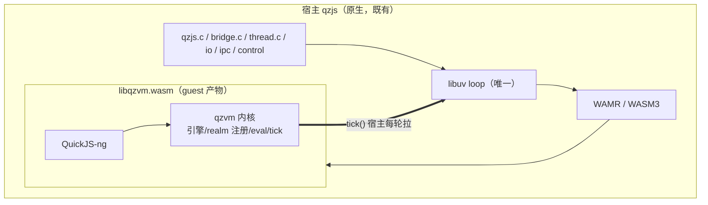

# in-module 档设计

**状态**：设计定稿，待实现
**范围**：把 qzvm（QuickJS-ng + qz.\* 原语）编到 wasm32 作**模块内 guest** 的构建形态
**方法**：第一性原理推导 guest 真需要什么 + 奥卡姆剃刀取最小产 —— **不追求最小改动**

---

## 1. 问题重述（第一性）

初版设计把问题设成「如何让现有 `QZVM_SOURCES` 三源（741 行）脱离 libuv 照编」，方案是给 uv 打 stub 头。**这是错的**——它默认"现有三源是 guest 的正确单元"，但事实是：

> 三源不是**设计出来的单元**，是 `src/qzvm/` 被切出来时"恰好在那里"的全部代码。它与 guest 的需要**没有对应关系**。

正确的第一性问题：

> **一个内嵌到 wasm 的 JS 引擎模块，运行时最少需要哪些能力？**

## 2. 事实（已核实）

### 2.1 三源职责拆解

`context.c`（455 行）各函数归属：

| 函数 | 真实职责 | guest 需要？ |
| --- | --- | --- |
| `qz_get_active_ctx/_jsctx/_by_id` | 查询活动 realm | ✅ 内核 |
| `qz_ctx_create` / `qz_ctx_create_at` | 建 realm（JSContext + 注册进 `rt->contexts`）；**内含** pal 构建 / polyfill 装载+注入 / ext 登记（边界接线，见 §3.1） | ⚠️ 内核骨架 + 混入边界 |
| `qz_ctx_destroy` | 拆 realm | ✅ 内核 |
| `qz_ctx_cleanup_resources` | 循环 `qz_timer_cancel`（见 2.3） | ⚠️ timer 归宿主 |
| `qz_ctx_spawn` | 建**子 context** | ❌ 宿主编排（仅 `bridge.c:2117` 调） |
| `qz_ctx_serialize` | realm 状态**写盘** | ❌ 宿主（`bridge.c:2135`） |
| `qz_ctx_rebuild` | 从盘**重建** realm | ❌ 宿主（`bridge.c:2155`） |
| `qz_ctx_destroy_id` | 按 id 拆 | ❌ 宿主（`bridge.c:2172`） |
| `qz_write_file` / `qz_read_file` | 序列化的文件 I/O | ❌ 宿主 |

`vm_core.c`（182 行）：`qz_eval_internal` / `qz_eval_bytecode_internal` / `qz_get_rt_from_ctx` / `qz_get_rt_from_jsrt` / `qz_compile` —— **全部内核**，guest 全要。

`ext_lifecycle.c`（104 行）：`qz_ext_init/destroy_all`（机制内核，调用时点归边界）+ `qz_ext_suspend/resume_all`（仅 suspend/resume 用 = 宿主编排，**零外部调用者**）。

### 2.2 扩展源可无痛进 guest

`ext_compress.c` / `ext_crypto.c` / `ext_textcodec.c` **均零 `uv_` 引用**（仅链 miniz/mbedtls + 字符串）。故「扩展让在 wasm 里跑吗」的答案是**能**——它们是纯计算，无 OS 依赖。裁剪扩展不是 libuv 问题，是**体积/攻击面**取舍。

### 2.3 libuv 依赖的真实形态

| 依赖 | 位置 | 性质 |
| --- | --- | --- |
| `qz_t` 值内嵌 `uv_loop_t loop` / `uv_thread_t thread` / `uv_async_t wake` | `qz_core.h:86-88` | **结构混装**：引擎态与宿主线程/loop 同结构 |
| `qz_t` 内 `qz_msg_t` → `struct uv__queue q` | `qz_core.h:94-102` + `qz_msg.h:35` | 消息队列 = 宿主 IPC，内嵌 uv 队列节点 |
| `qz_core.h:191-310` `#ifndef QZ_USE_MOCK_LIBUV` 块 | `store`/`http_ops`/`proc`/`ipc_channel_pipe`/`dap_timer`/`ctl_*` | 宿主 I/O、进程、控制面 |
| `qz_close_loop`（header inline，调 `uv_loop_close`） | `qz_core.h:330` | 宿主 loop 诊断，**仅宿主源调用**（`qzjs.c:715` 等） |
| `qz_types.h:26-30` 无条件 `#include <uv.h>` | `qz_types.h` | 因 qz_t 内嵌 uv 而被迫 |
| `qz_timer_cancel` 调用 | `context.c:73` | 在 `handle_count` 循环内；guest 无 timer → 恒 0 迭代 |

**根因**：`qz_types.h` 必须 include uv，唯一原因是 `qz_t` **按值内嵌** uv 类型。`test/mock_libuv.h`（280 行，依赖 `<pthread.h>`/`<sys/socket.h>` 等 POSIX）正是为掩盖这点而存在——它让测试能编过，但**语义上是把宿主实现换成一个假实现**，而 guest 根本不要任何实现。

### 2.4 tick 原语已存在

`src/host/thread.c:22` 的 `qz_flush_microtasks` = `while (JS_ExecutePendingJob(...))` 的薄封装，**零 libuv**。tick() 即此物，仅位置在宿主层。

### 2.5 分层现状

触 libuv 的源：`src/qzvm/` 仅 `debugger_dap.c`（可选）；`src/host/` 6/8；`src/io/` 2/2；`src/ipc/`、`src/control/`、`src/msg/` 各含。宿主公共头 `qzjs.h`（338 行）**已 uv-free**（`qz_t` 不透明）。

---

## 3. 第一性推导：guest 最小能力集

从「内嵌 wasm 的 JS 引擎模块要跑什么」推导，不引用现有文件边界：

| 能力 | 必要性 | 依据 |
| --- | --- | --- |
| 引擎（QuickJS-ng JSRuntime） | **必须** | 无引擎无 JS |
| realm（JSContext + 全局） | **必须** | 脚本要有全局环境 |
| realm 注册（ctx 进 `rt->contexts`） | **必须** | 跑任何 JS 前，闭包需经 `get_ctx_from_jsctx` 反查（`context.c:152-154`） |
| 字节码加载 / eval | **必须** | 执行入口（已有 `qz_eval_bytecode_internal`） |
| microtask pump（tick） | **必须** | promise/microtask 推进 |
| **宿主线程 / loop** | **不要** | libuv 属宿主（已定约束） |
| **消息队列 / IPC** | **不要** | 宿主边界机制，非引擎能力 |
| **进程编排**（spawn/serialize/rebuild/destroy_id） | **不要** | 仅经 pal/bridge 从宿主到达 |
| **文件 I/O** | **不要** | OS 能力，属宿主 |
| **timer 实现** | **不要** | 同 IO，走 pal 回流宿主 |
| **控制面 / DAP / storage** | **不要** | 宿主基础设施 |
| **polyfill 注入** | **不要**（★修正） | 见 §3.1：是宿主边界接线，非引擎能力 |
| **扩展登记（ext init/destroy）** | **机制留、调用时点归边界**（★修正） | 遍历常表调钩子 = 核心机制；但内容依赖注入产生的 `__native__`，故由宿主在接线后调。见 §3.1 |

**结论**：guest 最小集 = **引擎 + realm 生命周期（含注册）+ eval/compile + tick**。粗估 **~300–350 行**（`vm_core.c` 182 全留 + `context.c` 建拆 realm ~105 + `ext_lifecycle.c` init/destroy ~50），而非 741——差额是混进来的**边界接线**（pal/polyfill/ext 登记）+ 宿主编排 + 文件 I/O + timer 缝合。

### 3.1 为什么 polyfill 注入与扩展登记不属核心（第一性）

初稿把「polyfill 注入」列为必需——**错**。注入**动作**虽在 `context.c:160-215`（56 行），但它的每一环都是宿主需求：

| 注入所需 | 位置 | 性质 |
| --- | --- | --- |
| `qz_create_pal_object_ctx` | `bridge.c:2226` | 注册 **48 个** `pal.*`（`timerStart`/`httpRequest`/`fsRead`/`processSpawn`…）——**全是宿主 I/O** |
| `qz_polyfill_load` / `qz_default_polyfill` | `src/host/polyfill_load.c` | 宿主加载器（rodata/compressed/external/host 四模式） |
| polyfill bundle | `src/polyfill/src/*.js` | `var pal = globalThis.__native_inject__` + fetch/fs/console/url…——**pal 之上的宿主 glue** |

即 `context.c:163` 直接调 `bridge.c` 的函数——**这已是分层违规**（qzvm 调宿主）。

注入块四步拆解：

| 步骤 | 属核心？ |
| --- | --- |
| 建 pal object | ❌ 纯宿主（48 个宿主函数） |
| set `__native_inject__` 全局 | ⚠️ 通用机制，但服务于 pal |
| eval bytecode | ✅ 已有 `qz_eval_bytecode_internal`（重复实现） |
| `__native_inject__`→`__native__` 改名 | ❌ 是 polyfill build 约定（`build.js`），非引擎 |

**连带**：`textcodec_ext_init`（`ext_textcodec.c:225`）读全局 `__native__`——由注入产生。故 `qz_ext_init_all` **硬依赖**注入先跑。

→ **注入 + 扩展登记 = 同一件事：宿主边界接线（pal 面）**。两者都从 `qz_ctx_create_at` 移出。

## 4. 奥卡姆裁决

| 方案 | 结论 | 理由 |
| --- | --- | --- |
| **stub uv 头**（初版 M2） | ❌ 否 | 让 guest 编译它**永不执行**的代码（timer 路径、loop 关闭、消息队列）。奥卡姆：不执行的分支也是分支，是缺陷机会 + 攻击面。极简哲学：**删优于加** |
| **复用 mock_libuv 类型部分** | ❌ 否 | mock 是**要真跑的替代实现**（带 pthread/POSIX），in-module 是**不要实现**——语义错配。且拖 POSIX 头 |
| **profile 换 extends 源集** | ⚠️ 半是 | `QZ_PROFILE` 选**标志**对；但 guest 产物是**另一个 artifact**（.wasm，非 libqzjs），源集是**子集**——profile 语义（同源不同 flag）不贴。需独立 target |
| **按能力切分 qz_t / 拆 context.c** | ✅ 采用 | 唯一消除根因（结构混装）的方案。切完 `qz_types.h` 的 uv include 对 guest 变**不可达**，无需 stub |

**裁决**：**终态即起点**——不设「先 stub 过渡、后切分」的两阶段。第一性上没有"过渡"这个物：若要切分，就切；若不切，就不该编那 741 行。两阶段 = 先制造再拆除负债，纯浪费。

## 5. 结构切分设计

### 5.1 qz_t 按能力分块

**事实**：`qz_t` 字段是**交错**的，不是「核心在前、宿主在后」（`qz_core.h:79-311` 实读）：

| 行段 | 字段 | 归属 |
| --- | --- | --- |
| 80-81 | `magic` / `jsrt` | 核心 |
| 86-88 | `uv_loop_t loop` / `uv_thread_t thread` / `uv_async_t wake` | **uv** |
| 94-102 | `msg_head/msg_tail/msg_stub`、`qz_mq_t mq_out`、`out_efd`/`out_claim`/`out_fault` | **uv**（消息队列） |
| 104-148 | `shutting_down`/`wait_idle`/`thread_*`/`config`/`strict_*`/`host_emit`/`debug` | 混合（`config` 核心，其余宿主） |
| 163-165 | `ca_pem*`（TLS） | 宿主 |
| 166-175 | `contexts[]`/`context_count`/`active_ctx_id`/`polyfill*` | 核心 |
| 181-182 | `worker_self`/`workers[]` | 宿主 |
| 184-305 | self_path/storage_relays/proc_handles/proc/ipc/dap_timer/ctl_* | 宿主 |
| 305-310 | `#ifndef QZ_USE_MOCK_LIBUV` 的 `ctl_listener` 块 | **uv** |

故切分**不能整块加 `#ifndef`**，须逐字段归类（或重排为「核心块 + 宿主块」）。示意：

```c
struct qz_t {
    uint32_t magic; JSRuntime *jsrt;
    qz_config_t config;
    qz_ctx_t *contexts[QZ_MAX_CONTEXTS];
    int context_count, active_ctx_id;
    /* polyfill 缓存归宿主（§3.1）；以下全部宿主专属 */
#ifndef QZ_VM_GUEST
    uv_loop_t loop; uv_thread_t thread; uv_async_t wake;
    qz_msg_t *msg_head, *msg_tail, msg_stub; qz_mq_t mq_out; int out_efd;
    qz_proc_t *proc; uv_pipe_t *ipc_channel_pipe;
    uv_io_store_entry_t *store; struct uv_io_http_op_t *http_ops;
    uv_timer_t dap_timer; uv_mutex_t ctl_lock; uv_pipe_t ctl_listener;
    /* …workers/ctl/self_path 等… */
#endif
};
```

`qz_ctx_t` 字段归属（`qz_core.h:17-33`）：

| 字段 | 归属 |
| --- | --- |
| `jsctx` / `context_id` / `extensions` / `extensions_count` | 核心（`extensions` 表是编译期常表，机制核心；登记动作归边界） |
| `polyfill*`（`qz_ctx_t` 上的缓存） | 边界（见 §3.1：内容属宿主） |
| `handles[]` / `timer_resolves[]` / `timer_cbds[]` / `handle_count` | 宿主（timer 句柄表） |
| `suspended`（vestigial，注释明示恒 0） | 可删（奥卡姆） |

**关键**：`qz_types.h:26-30` 的 uv include 移进 `#ifndef QZ_VM_GUEST`（或按 `qz_core.h` 依赖重排）。guest 编译时 uv 类型**完全不可达**——不是 stub，是**不存在**。

### 5.2 context.c 拆分

`qz_ctx_create_at`（`context.c:101-240`）当前混装三件事，按 §3.1 拆开：

| 步骤 | 去向 |
| --- | --- |
| 分配 ctx + 建 JSContext（`:101-127`） | **留内核**（realm 建立） |
| polyfill **装载**（`qz_polyfill_load`，`:129-143`） | **移边界**（内容属宿主，§3.1） |
| ctx 进 `rt->contexts`（注册，`:152-158`） | **留内核**（跑任何 JS 前需注册，供 `get_ctx_from_jsctx` 反查） |
| 建 pal + 装 polyfill + 改名 `__native__`（`:160-213`） | **移边界**（宿主接线） |
| `qz_ext_init_all`（`:228`） | **移边界原语**（机制可留 VM，调用点归宿主，§5.3） |
| 删 `WebAssembly` 全局（`:215-226`） | 引擎裁剪动作，可留内核 |

| 函数 | 去向 |
| --- | --- |
| `qz_ctx_create/_at/_destroy`、`qz_get_active_*` | 留 `context.c`（内核）；`_at` 去掉边界接线 |
| `qz_ctx_spawn/_serialize/_rebuild/_destroy_id` + `qz_read_file`/`qz_write_file` | 移 `host/ctx_orchestrate.c`（宿主编排） |
| `qz_ctx_cleanup_resources` 的 `qz_timer_cancel` 循环 | 宿主侧 timer 清理 |

**附带发现（奥卡姆）**：`qz_inject_polyfill_ctx`（`bridge.c:2334`）**零调用者**（仅 `qz_rt.h:110` 声明）——是注入逻辑的重复实现（`qz_ctx_create_at` 内联了同一套）。拆分时**删**，不搬。

`ext_lifecycle.c`：`qz_ext_suspend_all`/`qz_ext_resume_all` 无外部调用者 → 随 suspend 机制归宿主或删除（奥卡姆：无消费者的保留 = 负债，需单独裁决）。

### 5.3 内部接口（VM ↔ 宿主）

切分后，宿主源（`qzjs.c`/`thread.c`/`bridge.c`）需要调用 VM 的一小组符号。这**就是**内部接口——**不是"没有接口"**，是一个**极小的内部契约**（初版此处措辞有误）：

| 宿主需要 | VM 提供 |
| --- | --- |
| 建/拆 realm | `qz_ctx_create` / `qz_ctx_destroy`（**内核**：建 JSContext + 注册；不含边界接线） |
| 取活动 ctx | `qz_get_active_*` |
| 推 microtask | `qz_tick`（← `qz_flush_microtasks` 上移） |
| eval/compile | `qz_eval_internal` / `qz_compile` |

**边界接线不在此接口内**（§3.1）：建 pal、装 polyfill、`qz_ext_init_*` 由**宿主**在 VM 建完 realm 后调。即初始化序列从 `qz_ctx_create` 单体变为：

```
VM:  qz_ctx_create()         → realm 建好、已注册
宿主: build_pal(ctx)         → 装 pal 面
宿主: inject_polyfill(ctx)   → eval bundle
宿主: qz_ext_init_all(ctx)   → 扩展登记（依赖前两步）
宿主: qz_tick()              → 每轮拉
```

因是**单一 wasm 产物的内部实现**，此接口无 ABI 承诺（宿主 native 形态直接 C 调；guest 形态是模块内部调用）——brain 结论成立，且正因为无承诺，把它**设计紧**是零代价的。

### 5.4 tick 拉模型

`qz_tick(qz_t *)` = `while (JS_ExecutePendingJob) > 0`，从 `src/host/thread.c:22` 上移到 qzvm。宿主每轮 libuv iteration 调它拉模块推进。模块 reactive，不自带 timer/loop/阻塞。复用点 `qzjs.c:643/655`、`thread.c:22` 统一改调 `qz_tick`。

## 6. 构建形态

`QZ_PROFILE=in-module`（已落地 `d365171e`）职责 = **选标志**（引擎 OFF、扩展 OFF 等）。新增职责 = **选源集 + 定 artifact**：

- 新增 CMake target `qzvm-guest`，源集 = 内核源（`context.c` 内核部 + `vm_core.c` + `ext_lifecycle.c` 内核部）+ quickjs-ng +（可选）纯计算扩展。
- 输出 `libqzvm.wasm`（导出 `qz_create`/`qz_eval*`/`qz_tick`/`qz_destroy`），**非** `libqzjs.so`。
- 宏 `QZ_VM_GUEST` 由该 target 下发，驱动 5.1 的条件编译。



## 7. 里程碑

| # | 里程碑 | 产物 | 验证 |
| --- | --- | --- | --- |
| M1 | qz_t/qz_ctx_t 能力切分 | `qz_core.h` 加 `#ifndef QZ_VM_GUEST` 块；`qz_types.h` uv include 条件化 | **native 全回归绿**（切分不改宿主行为）；`-DQZ_VM_GUEST -fsyntax-only` 内核源 uv 不可达 |
| M2 | context.c 拆分（含边界接线移出） | §5.2：pal/polyfill/ext 登记移出内核；宿主编排移新文件；删死码 `qz_inject_polyfill_ctx` | native 回归绿；`qz_ctx_create/destroy` 内核部零 uv、零 `bridge.c` 调用 |
| M3 | tick 上移 | `qz_tick` 入 qzvm；宿主改调 | native 回归绿（tick 语义不变） |
| M4 | wasm32 工具链 + guest target | `cmake/wasm32.cmake` + `qzvm-guest` target | `libqzvm.wasm` 链接成功，导出符号齐 |
| M5 | guest 跑通 | import 面 + 最小 host 驱动 | 模块内 `eval("1+1")` 返回 2；一次 tick 推进 promise |

**M1–M3 全部在 native 上验证**（切分是纯重构，宿主行为不变）→ 风险最低、最先做。M4–M5 才引入 wasm 工具链不确定性。

**相比初版**：删除了「stub uv 头」（负债）；把「native 回归」作为每一步的护栏（而非一次 configure）；最小可验证提前到 M1。

## 8. 最小配置

```bash
# guest 产物（新 target）
cmake -S . -B build-inmod -DQZ_PROFILE=in-module \
  -DCMAKE_TOOLCHAIN_FILE=cmake/wasm32.cmake
cmake --build build-inmod --target qzvm-guest
```

- 引擎 flag（`QZ_WITH_WAMR/WASM3=OFF`）由 profile 提供（已落地 gate 逃逸）。
- 扩展：默认全 OFF（最小）；如需标准面可逐个开（`ext_*.c` 零 uv，可进 guest）。
- 源集由 target 决定（内核源），**不再依赖 `QZVM_SOURCES` 全表**。

## 9. 风险与未决

| 风险 | 说明 | 缓解 |
| --- | --- | --- |
| qz_t 切分面广 | `qz_t` 被 N 个源引用；搬字段需同步改 `rt->field` | M1 靠编译器逐个暴露；每步 native 回归 |
| 边界接线移出的连带 | pal/polyfill/ext 登记移出 `qz_ctx_create_at` 需重排初始化顺序（注册→边界→ext init） | M2 逐步；native 回归 |
| `qz_ctx_create` 内核部仍有 host 导入 | 当前 `context.c` 调 `qz_create_pal_object_ctx`/`qz_polyfill_load`/`qz_timer_cancel`（全 host） | M2 移出后内核部零宿主导入 |
| 工具链选型 | wasi-sdk vs emscripten | 倾向 wasi-sdk（freestanding，贴合自包含）；M4 定 |
| `qz_ext_suspend/resume_all` 无调用者 | 是死码还是待接 | 单独裁决：无消费者则删（奥卡姆）或随 suspend 归宿主 |
| 扩展内容取舍 | 全 OFF 最小，但 guest 的标准面（如 console/URL）依赖 polyfill 非 C 扩展 | M5 定 polyfill 注入的最小集 |

## 10. 参考

- 决策原则：brain `decision-principles`（苏格拉底式提问 / 第一性原理 / 奥卡姆剃刀 + 极简哲学）
- 决策链：brain `aot-experiment-verification`（2026-10-13 全部条目）
- 相关设计：`STR_BACKEND_DESIGN.md`、`ASSESSMENT.md`、`PORTABILITY_32BIT.md`
- 已落地：提交 `d365171e`（profile 档 + gate 逃逸）
- 证据点位：`qz_core.h:79-311`（qz_t）、`:17-33`（qz_ctx_t）、`qz_types.h:26-30`、`context.c:101-240`（`qz_ctx_create_at` 混装）、`bridge.c:2117-2172`（编排）、`bridge.c:2226`（pal 面）、`bridge.c:2334`（死码注入）、`src/host/polyfill_load.c`、`textcodec_ext.c:225`（ext 依赖 `__native__`）、`thread.c:22`（tick）
